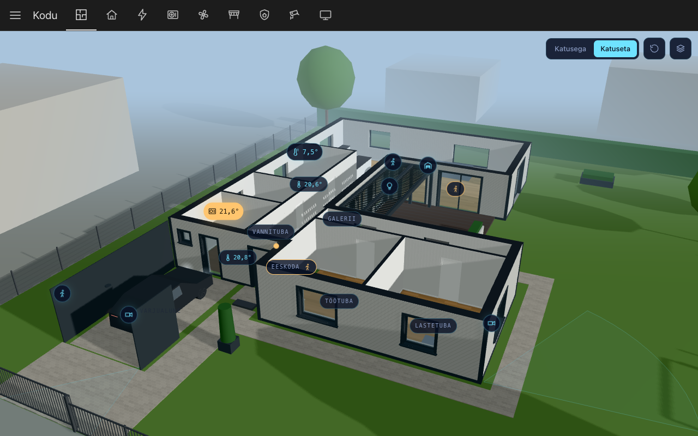

# khe-home-assistant

The Home Assistant configuration of one house, public as a reference: the
YAML packages, a generator for the dashboard, small tools for HA's API, and a
3D view of the house that shows the devices in place.

[](https://khe.ee/ha/)

**[Try the dashboard](https://khe.ee/ha/)**: the house's own dashboard,
made by the same generator, on a made-up test house with simulated devices
and made-up charts. The 3D view comes first, then home, energy, heat pump,
ventilation, pergola, alarm, cameras and TV; tap a tile to control it as in
Home Assistant, and watch the car drive in through the gate. The toolbar's
scenarios play short stories on it, such as coming home, a break-in at night
or rain on the pergola, and mark what the house's real automations do.

## What is interesting here

- **One package per device or concern.** The heat pump, ventilation, alarm,
  pergolas, energy prices and the TV each sit in their own file under
  `config/packages/`, with the reasoning in its header comment.
- **The dashboard is generated, not clicked together.** A Python script
  writes the whole Lovelace config through HA's WebSocket API, so the layout
  is reviewed and versioned like the rest.
- **Local first.** The ventilation unit is read over Modbus, the heat pump
  through its local API, the alarm panel through MQTT, and the pergolas
  through tuya-local, because their roof control is reachable over the LAN
  only (and they report no roof position at all).
- **The deploy checks before it copies.** A push runs `check_config` inside
  the running HA image, and only a passing configuration reaches HA.
- **Identifying data never enters the repo.** Device ids, local keys,
  addresses and names live in private storage, and every piece of code that
  needs them leaves its card or entity out when they are missing.
- **The 3D view** is generated from a private model of the house: walls,
  roofs, rooms, the yard, the neighbourhood from the national topographic
  database, and live device markers. It runs as a custom card inside HA.

The quirks behind each of these are in
[docs/operational-notes.md](docs/operational-notes.md).

## How it deploys

A push to `main` that changes the configuration, the 3D view or the
dashboard's own cards runs a workflow on the homelab's own runner. It validates the configuration with
`check_config` inside the running HA image, then copies it into HA's config
volume. It never restarts HA: a reload or a restart through the API makes
the new configuration live. HA's `.storage`, the recorder, the container and
its backup stay on the server and in
[khe-homelab](https://github.com/khelias/khe-homelab).

## Checks

```bash
bash scripts/check.sh
```

## More

- [AGENTS.md](AGENTS.md) - layout, commands, rules and how HA is operated
- [docs/operational-notes.md](docs/operational-notes.md) - integration quirks
  and the 3D view
- [ROADMAP.md](ROADMAP.md) - where the house automation is going
- [khe-architecture](https://github.com/khelias/khe-architecture) - the
  estate this repo belongs to

## License

[MIT](LICENSE)
